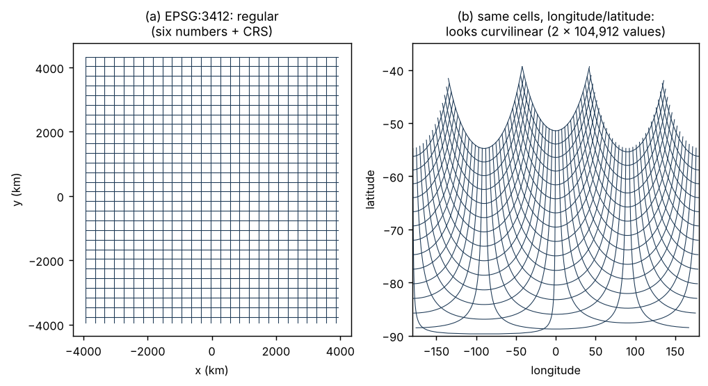

# One file, two grids {#sec-problem}

## A sea ice file

A monthly CryoSat-2 sea ice product for the Southern Ocean is distributed as
a netCDF file. Open it and you find a 316 by 332 array of values, and beside
it two more arrays of exactly the same shape: `lon` and `lat`, one longitude
and one latitude for every cell. There is no coordinate reference system in
the file and no geotransform. By the conventions most readers follow, this
is a curvilinear grid: the coordinates are two-dimensional, so the grid is
treated as one whose cells must each be located individually.

Anyone who has worked with Antarctic sea ice recognises the shape. 316 by
332 at 25 km is the NSIDC polar stereographic south grid, EPSG:3412. That
grid is completely described by its dimension and four extent values:

```
dimension: 316 x 332
extent:    -3950000  3950000  -3950000  4350000   (xmin xmax ymin ymax, metres)
crs:       EPSG:3412
```

The file replaced those six numbers and a CRS code with 209,824 floating
point values. The recovery of the original grid from those values is worked
through in @sec-case-cryosat; it comes back to within a few tens of metres,
which on a 25 km grid is floating point noise.

{#fig-nsidc}

@fig-nsidc shows what happened. On the left is the grid in its own frame:
straight rows and columns, evenly spaced. On the right are the same cell
centres written as longitude and latitude. The lines bend, the spacing
varies, the longitude range runs from -179.8 to 179.8 because the
antimeridian passes through the middle of the grid. Nothing about the cells
changed. What changed is the frame the positions are written in.

## So is it curvilinear?

It depends on what the word is being asked to mean, and in practice it is
asked to mean at least three things:

1. **The coordinates are stored as 2D arrays.** True of this file. This is a
   fact about storage.
2. **The grid is in geographic coordinates.** Also true of the stored
   coordinates. This is a fact about the frame.
3. **The cells cannot be placed by any rule simpler than listing them.**
   False. This is the geometric meaning, and it is the one that matters for
   what you can do with the data.

When the three meanings travel together under one word, a reader who sees
meaning 1 assumes meaning 3. Software that sees 2D coordinate arrays labels
the grid curvilinear and stops looking. An analyst who has a polar
stereographic grid in hand resamples it onto a longitude and latitude grid
before doing anything, because "curvilinear data has to be regridded". A
data producer who writes longitude and latitude for every cell believes they
have done the careful thing.

## What it costs

The costs are concrete:

- **Size.** Six numbers became 209,824 values for this grid, about 35,000
  times more. For a GOES geostationary full disk at 2 km, 5424 by 5424 cells,
  the same choice turns six numbers into nearly 59 million
  (@sec-case-goes).
- **Precision.** The stored coordinates are less exact than the six numbers
  they replace. They have been through trigonometry and usually through
  32-bit storage. The original grid had no error at all.
- **Lost meaning.** The CRS is gone. Anything that needs distances, areas
  or neighbourhoods in metres must reconstruct it from external knowledge.
- **Needless resampling.** Tools that only see "curvilinear" route the data
  through interpolation to put it on a regular grid, which it already was.
- **Friction.** Someone has to notice. In the original write-up of this file
  the six numbers were "plucked out of the air" because the author already
  knew the NSIDC grid. Nothing in the file says so.

None of this is anyone's mistake in isolation. Each step that produced this
file was reasonable within some community's habits. @sec-communities is about those habits.

## The rest of the book

The way through is to stop asking "is this grid curvilinear?" and ask two
separate questions instead. @sec-two-questions sets those out.
@sec-costumes shows how many different ways one grid can be stored,
and which of them hide its real structure. The later chapters compare how
communities and software answer the two questions, give a field guide for
working out what you actually have, and work through real cases.
