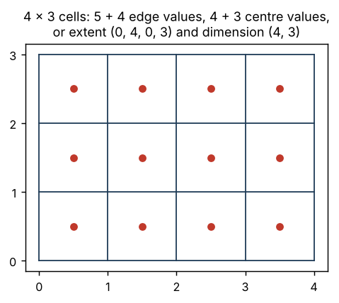

# Two questions {#sec-two-questions}

## Question one: how are positions worked out from the index?

Every gridded dataset is an array, and every cell has an index: a row and a
column, or more generally one integer per dimension. The first question is
how much information you need, beyond the index, to say where each cell is.

There is a well established ladder for this, used in scientific
visualisation (the VTK data model has a class for each rung) and in Earth
system modelling (ESMF, following Balaji's grid standards work). Each rung
relaxes one constraint and needs more stored information than the one
before.

**Regular.** Positions follow from the index by arithmetic alone. The grid
is specified by its dimension and an origin and step in each direction, or
equivalently by its dimension and extent. That is six numbers for a 2D grid:

```
ncol, nrow, xmin, xmax, ymin, ymax
```

The GDAL geotransform is the same information arranged as an affine
transform (origin, step and two shear terms that are zero for an axis-aligned
grid). Writing the cell centres out as coordinate vectors adds no
information; they are derived values.

**Rectilinear.** Rows and columns are still straight and at right angles,
but spacing varies along each axis independently. The grid needs one vector
of positions per axis: `nx + ny` values. Every cell is at
`(x[i], y[j])`, the outer product of two 1D sequences. Pressure levels,
stretched ocean model grids and some reanalysis products are rectilinear in
this sense.

**Curvilinear.** Cells are still indexed by row and column, and each still
has four neighbours, but their positions cannot be written as an outer
product of two sequences. The grid needs a position per cell for each
coordinate: `2 * nx * ny` values for a 2D grid.

**Unstructured.** There is no row and column index at all. Cells are
numbered, and which cells neighbour which must be stored explicitly.
Triangular meshes, hexagonal MPAS grids and point clouds are unstructured.

| Type | Positions | Stored | CF signal |
|---|---|---|---|
| Regular | implicit, origin plus step | 6 numbers | 1D coordinates, uniform spacing |
| Rectilinear | outer product of two 1D sequences | nx + ny values | 1D coordinates, varying spacing |
| Curvilinear | explicit per cell, still indexed by (i, j) | 2 nx ny values | 2D auxiliary coordinates |
| Unstructured | explicit per cell plus connectivity | positions and topology | UGRID |

: The index-mapping ladder. {#tbl-ladder}

The first three rungs are what Balaji calls *logically rectangular*: in
index space every cell is a box. His phrasing is worth keeping: "The
coordinate space may continue to be physically curvilinear; yet, in index
space, grid cells will be rectilinear boxes." The containment is strict.
Every regular grid is rectilinear, and every rectilinear grid could be
stored as curvilinear, wastefully.

## Question two: in which frame?

The ladder says nothing about what the positions *are*. They have to be
numbers in some coordinate frame, and there are several kinds:

- **Geographic longitude and latitude**, on some model of the Earth.
- **Projected coordinates**, usually metres (sometimes kilometres), defined
  by a projection family, a centre, a few parameters and an Earth model.
- **Rotated longitude and latitude.** Angular coordinates on a sphere whose
  pole has been moved, as CF's `rotated_latitude_longitude` and PROJ's
  `ob_tran`. These look like longitude and latitude, and are measured in
  degrees, but they are not geographic.
- **Projected but angular.** The GOES geostationary fixed grid stores `x` and
  `y` as scan angles in radians. Multiplied by the satellite height they
  become metres in PROJ's `geos` projection.
- **No frame.** Index space only: row and column numbers, or the unit square
  some plotting functions assume. This is a useful frame in its own right
  (@sec-index-space).

## The answer to one depends on the other

Here is the point of the book. The first question has no answer until the
second is fixed. A grid is regular, rectilinear or curvilinear *in a
frame*, and the same cells give different answers in different frames:

| Grid | In its native frame | In geographic longitude and latitude |
|---|---|---|
| NSIDC 25 km south, EPSG:3412 | regular | curvilinear |
| CORDEX rotated-pole model grid | regular (rotated longitude/latitude) | curvilinear |
| AVISO global Mercator | regular (Mercator) | rectilinear |
| GOES ABI full disk | regular (scan angle, or `geos` metres) | curvilinear, partly undefined |
| OISST quarter degree | regular (longitude/latitude) | regular |
| MODIS land tile (SIN grid) | regular (sinusoidal) | curvilinear |
| NEMO ORCA tripolar | curvilinear | curvilinear |
| VIIRS level 2 swath | curvilinear | curvilinear |

: The same grids answered in two frames. {#tbl-frames}

Only the last two rows are curvilinear in every frame. They are what people
should mean by "curvilinear", and they are a minority of the grids that get
the label.

Two consequences follow, and both come back repeatedly.

**"Curvilinear" without a frame is underspecified.** A grid that is
curvilinear in longitude and latitude may be regular in some other frame.
The useful statement is "regular in EPSG:3412" or "curvilinear in every
frame we tried".

**"Longitude and latitude" says nothing about regularity.** OISST is regular
in longitude and latitude. A rotated-pole grid is regular in a longitude and
latitude frame too, just not the geographic one. Being in degrees does not
make a grid curvilinear, and being curvilinear does not make it geographic.

## A third thing: storage

There is one more layer, and it is where most of the confusion lives. What a
file *stores* is a choice made by its producer, and it does not have to
match the grid's real structure. A regular grid can be stored as six
numbers, as two coordinate vectors, or as two full 2D arrays, in its own
frame or in another. Conventions like CF read the grid type from the shape
of the stored coordinate arrays, so the storage choice becomes the label.

@sec-costumes lists those storage forms. The short version: the
ladder describes geometry, the frame describes what the numbers mean, and
storage describes what the producer wrote down. Three different things,
routinely collapsed into one word.

## Things that are not part of either question

Several nearby issues are real and important, but they are separate from
the two questions, and mixing them in makes the picture harder to see.

- **Cell semantics.** Do coordinates refer to cell centres or corners
  (GeoTIFF's PixelIsPoint and PixelIsArea)? Are there `n` coordinates or
  `n + 1` edges? Are there CF `bounds` arrays? This is the half-pixel
  problem, and it exists on every rung of the ladder (@fig-centre-edge).
  Seen as a mesh (@sec-grids-as-meshes), centre and corner are face and
  node: a value at a corner belongs to a vertex, a cell average to a face.

{#fig-centre-edge width=60%}

Ocean and atmosphere models take this further with **staggered grids**.
On an Arakawa C-grid, for example, scalars such as temperature sit at
cell centres, the `i`-direction velocity on the two faces crossed by the
`i` axis, and the `j`-direction velocity on the two faces crossed by the
`j` axis. Each velocity is normal to its face, so it points along the
grid's own axes; those are east and north only when the grid lines follow
meridians and parallels, as in a longitude and latitude or Mercator grid.
On a rotated, projected or curvilinear grid they are not, and the next
paragraph comes back to what that means. Each variable has its
own set of positions, offset from the others by half a cell. In a frame
where the grid is regular that offset is just a shifted origin, still six
numbers per location. Stored as 2D longitude and latitude, it becomes a
full pair of arrays per location: ROMS writes `lon_rho`, `lon_u`, `lon_v`
and `lon_psi`, and NEMO writes `glamt`, `glamu`, `glamv` and `glamf`, each
with its latitude twin. The SGRID convention describes how those
locations relate (which dimensions are faces, which are nodes, and the
padding between them), much as UGRID does for meshes. It is not part of
CF. Staggering answers "where on the cell?", which is a different question
from the two in this chapter.

Staggering brings a frame question back in through vectors. Model
velocities are usually stored as components along the grid's own axes,
not as eastward and northward components. ROMS `u` and `v` run along its
`xi` and `eta` directions, and the grid file carries an `angle` variable,
the angle between the `xi` axis and east at each cell centre, so a reader
can rotate them. The same is true of a regular grid in a projected frame:
sea ice motion vectors on a polar stereographic or EASE grid are often
given along grid `x` and `y`, and GRIB has a flag saying whether winds are
relative to the grid or to east and north. Away from the projection's
central meridian grid north is not true north, and the angle between
them changes from cell to cell, even though the grid is regular. CF
separates the two with standard names: `sea_water_x_velocity` is along
the grid axis, `eastward_sea_water_velocity` is along the parallel.
Treating grid-relative components as eastward and northward produces
currents that look plausible and point the wrong way. Particle tracking
code such as Parcels rotates them before moving particles.

- **Numeric precision.** Coordinates stored as 32-bit floats carry noise.
  Whether a grid is "regular" is always a question with a tolerance.
- **The shape of the Earth.** The ladder is deliberately silent about the
  manifold. A regular longitude and latitude grid's left and right edges are
  the same meridian and its top row is one point, and nothing in the grid
  structure says so. That is a feature of the ladder, not a gap, and
  @sec-edges returns to it.
- **The word "dimension".** In array software a dimension is an axis.
  `lon(y, x)` is one 2D coordinate variable on two dimensions. It does not
  add dimensions. Coordinate dimension and topological dimension are
  different again; the trianglewins notes on dimension cover those.
