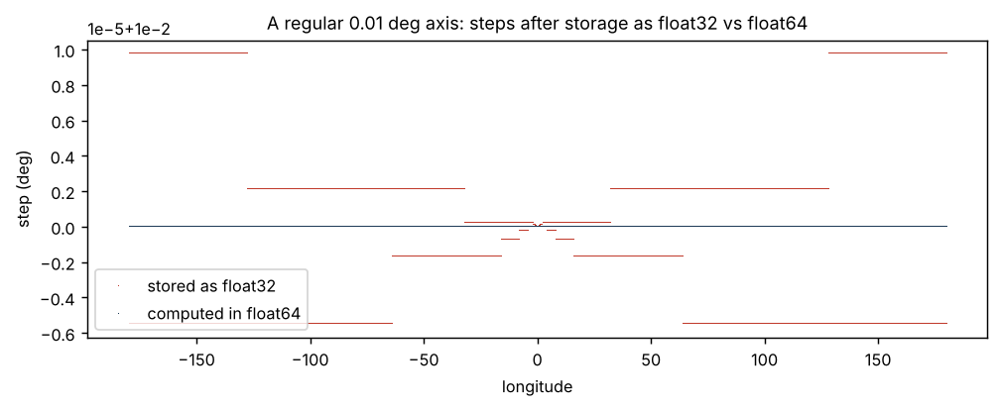
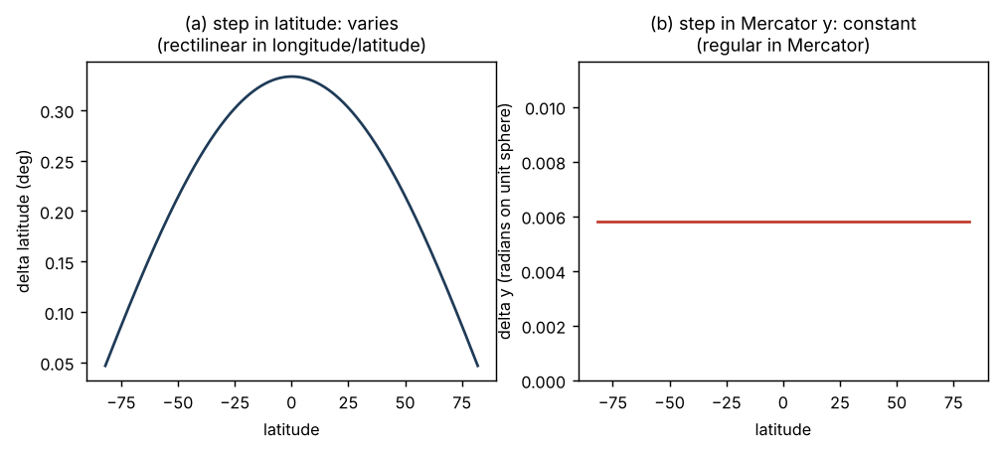
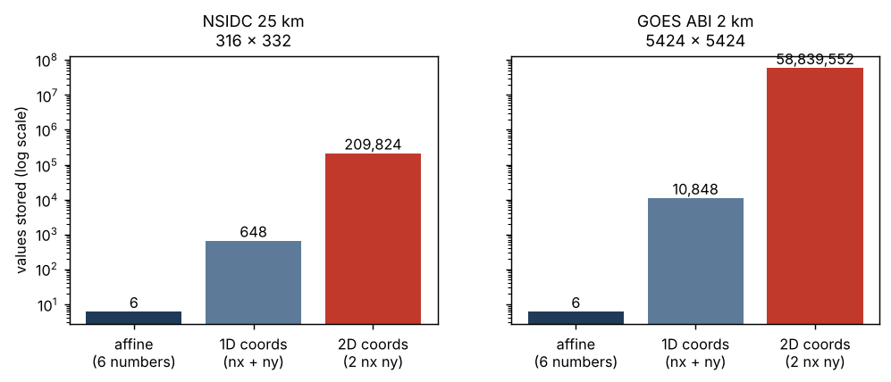

# One grid, many costumes {#sec-costumes}

## Ten ways to store the same thing

A regular grid can arrive in many forms, depending on what its producer
chose to write down. Some of these are genuinely different structures.
Others are the same information in a more expensive encoding. The earliest
version of this list (the rw-book draft) had eight cases labelled A to H;
two more are added here, because without them the frame question stays
hidden.

| | What is stored | Real geometry | Example | Common label |
|---|---|---|---|---|
| A | an array, no position information | unknown | a PNG, a raw binary | non-georeferenced |
| B | dimension plus affine transform (and CRS) | regular | GeoTIFF, COG | regular |
| C | 1D coordinate vectors, uniform spacing | regular | OISST, ERA5, GHRSST | rectilinear ("degenerate rectilinear") |
| D | 1D longitude and latitude vectors, latitude spacing varies | regular in Mercator | AVISO altimetry | rectilinear |
| E | 2D longitude and latitude arrays | regular in a projection | CryoSat-2 on EPSG:3412; CORDEX HCLIM and MAR | curvilinear ("cryptic curvilinear") |
| E2 | 2D longitude and latitude arrays, plus rotated 1D axes | regular in rotated longitude/latitude | CORDEX RACMO | curvilinear |
| E3 | 1D scan-angle vectors, CRS not carried | regular in `geos` | GOES ABI in a Zarr store | regular, frame unknown |
| F | 2D arrays of native projected x and y | regular in that projection | rare | curvilinear |
| G | 1D coordinate vectors, spacing genuinely varies | rectilinear | pressure levels, stretched grids | rectilinear |
| H | 2D coordinates, regular in no frame | curvilinear | NEMO ORCA, VIIRS swath | curvilinear |

: Storage forms of a grid, with what is underneath. {#tbl-costumes}

Only G and H store information that could not be recovered from six numbers
and a frame. Everything from C to F is a regular grid in costume.

The labels in the last column are what conventions and software would call
each case, judging from the stored arrays. They are wrong for C to F. Two of
those mislabellings are common enough to have names.

## Degenerate rectilinear

Case C is the netCDF default. A regular longitude and latitude grid is
written with a 1D coordinate variable for each axis, one value per cell
centre. The format allows the spacing to vary, which makes this rectilinear
storage, but the values are evenly spaced, so the grid is regular. The term
used for this on hypertidy.org since 2022 is *degenerate rectilinear*: a
rectilinear container carrying regular content.

This is mostly harmless, because a reader can test the spacing and recover
the six numbers. It becomes a problem in two ways.

First, the spacing test needs a tolerance, and 32-bit storage makes the
tolerance matter. @fig-float32 shows a regular 0.01 degree longitude axis,
like the one in the MUR GHRSST product (36000 columns). Computed in 64-bit
floating point, the steps vary by about 6e-14 degrees. Stored as 32-bit
floats, they vary between 0.0099945 and 0.0100098, a spread of about 0.15%
of a cell. A test that asks whether every step is exactly equal says this
grid is irregular. It is not.

{#fig-float32}

Second, the stored values may not even describe the intended grid
precisely. The GHRSST MUR files store 36000 longitudes and 17999 latitudes;
their longitude values are aligned to the right edge rather than centred,
there is a missing half-row at each pole, and the metadata claims a range of
-180 to 180 and -90 to 90 that the coordinates do not match. The six
numbers have to be decided by a person; the arrays only suggest them
(@sec-case-ghrsst).

## Hidden projections

Case D is subtler. The AVISO global altimetry products were computed on a
Mercator grid: regular in Mercator x and y. They were distributed with 1D
longitude and latitude vectors. Longitude is still evenly spaced, because
Mercator x is proportional to longitude, but latitude is not, because
Mercator y stretches toward the poles. The file therefore looks like a
genuinely rectilinear grid with variable latitude spacing (case G).

{#fig-mercator}

@fig-mercator shows the test that reveals it. Convert latitude to Mercator y
and the steps become constant to machine precision. The gproj detection on
a real AVISO file found a deviation of 1e-12. That is not a coincidence or
an approximation; the coordinates were computed from the formula.

Case E is the same story with both axes. A grid that is regular in a
projection, written out as longitude and latitude for every cell, becomes 2D
coordinate arrays. CF reads 2D auxiliary coordinates as a curvilinear grid,
and so does nearly every tool built on CF. The name for this used on
hypertidy.org is *cryptic curvilinear*: a grid that presents as curvilinear
but is regular in a frame the file has forgotten.

Cases E2 and E3 are the same pattern in frames that are easy to overlook.
A rotated-pole climate model grid is regular in rotated longitude and
latitude. Well-made files carry both the rotated 1D axes and the 2D
geographic arrays; some readers prefer the 2D arrays and see a curvilinear
grid (@sec-case-cordex). A GOES full disk image is regular in scan angle; if
the projection variable is lost in conversion, the 1D coordinates survive
but nobody downstream knows what they measure (@sec-case-goes).

## The entropy argument

Why care, if the arrays are correct? Because they are a strictly worse
encoding of the same grid.

{#fig-storage}

- **More data.** @fig-storage shows the counts. For the NSIDC grid, six
  numbers become 648 as coordinate vectors or 209,824 as 2D arrays. For GOES
  at 2 km, six become 10,848 or 58,839,552.
- **Less precision.** The six numbers are exact. Derived coordinates carry
  rounding from the projection maths and from storage, so the expensive
  encoding is also the noisier one.
- **Less meaning.** Six numbers and a CRS let any reader compute distances,
  areas and neighbourhoods in the native frame. Arrays of longitude and
  latitude do not say which frame was native.
- **More work downstream.** A regular grid can be subset, aligned and
  warped with index arithmetic. A curvilinear one needs search structures
  and interpolation.

The general rule for producers follows directly: if the grid is regular in
some frame, store the frame and the six numbers. Coordinate arrays are fine
as a convenience alongside them, never instead of them.

## The other side

It would be wrong to finish this chapter suggesting coordinate arrays are a
mistake. For cases G and H they are the only correct description. A tripolar
ocean grid cannot be written as six numbers in any frame; its 2D arrays are
the grid. A satellite swath follows the scan geometry of an instrument, and
its geolocation arrays are what the instrument measured. The climate
modelling community's habit of treating coordinate arrays as the complete
description of a grid is exactly right for its own models, which is why
that habit is so strong. The next chapter is about those habits, and why
reasonable people end up seeing the same file differently.
