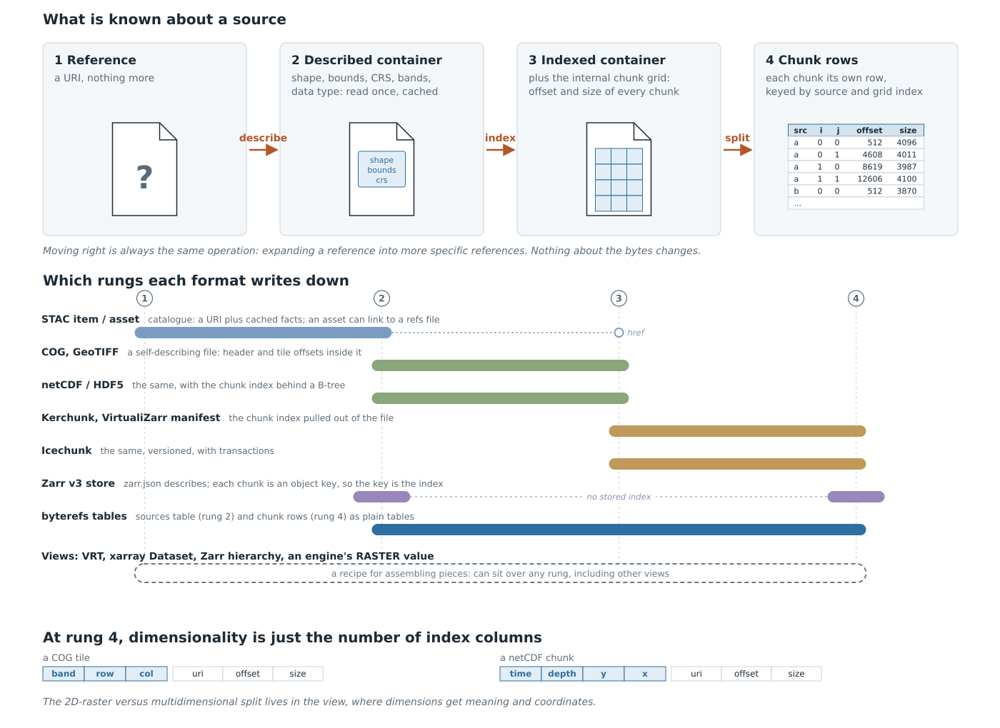

# One set of chunks, many containers {#sec-containers}

@sec-two-questions asked how a cell's position follows from its index, and
@sec-costumes showed how many ways the answer gets written down. There is a
second mapping every reader needs, and it is argued about just as loudly:
how do a cell's *bytes* follow from its index? Which object holds them, at
what offset, how many bytes, and how are they encoded?

The formats that answer this question are usually presented as rivals. A
STAC catalogue holds Zarr assets. No, a Zarr store embeds the catalogue and
supersedes it. A VRT wraps them both. Each claims to be the container the
others go inside. This chapter argues that they are not rivals at all. They
are serialisations of different steps of one progression, and most of the
argument is about which steps each one writes down.

## Four rungs of reference

Start with a single source, say one GeoTIFF or one netCDF file, and ask how
much is known about it.

| Rung | What is known | How you get there | Typical holder |
|---|---|---|---|
| 1 Reference | a URI, nothing more | (a file list, a crawl) | a list of paths |
| 2 Described | shape, bounds, CRS, bands, data type | read the header once, cache it | a catalogue item |
| 3 Indexed | plus the offset and size of every chunk inside it | walk the internal index | a reference manifest |
| 4 Chunk rows | each chunk its own record, keyed by source and grid index | split the index into rows | a table of references |

: The reference ladder: what is known about a source. {#tbl-reference-ladder}

Moving down the table is always the same operation: a reference is expanded
into more specific references. A URI becomes a described container, a
container becomes a list of chunk locations, a list becomes rows. Nothing
about the bytes changes. Only what has been written down about them.

Each step has a tool. Rung 2 is what `gdalinfo` prints and what a STAC item
caches. Rung 3 is in the file already, as TIFF tile offset and byte count
tags, or the B-tree index of an HDF5 dataset, and GDAL exposes it for
multidimensional sources through `GDALMDArray::GetRawBlockInfo()`. Rung 4
is the same information with one row per chunk, which is where it becomes
something a query engine can filter, join and aggregate.

{#fig-chunk-ladder .column-page}

## Rungs, not rivals

The middle panel of @fig-chunk-ladder places common formats against the
rungs.

| | Format | Rungs it writes down | Common label |
|---|---|---|---|
| P | STAC item and asset | 1 and 2; an asset can link to a rung 3 file | a catalogue |
| Q | COG, GeoTIFF | 2 and 3, inside the file | a raster format |
| R | netCDF-4 / HDF5 | 2 and 3, inside the file, behind a B-tree | a data format |
| S | Kerchunk, VirtualiZarr manifest | 3 and 4, outside the file | a virtual dataset |
| T | Icechunk | 3 and 4, outside the file, versioned | a transactional store |
| U | Zarr v3 store | 2 and 4, with no stored rung 3 | an array format |
| V | byterefs tables | 2, 3 and 4 as plain tables | a reference table |

: Formats by the rungs they write down. {#tbl-containers}

The labels in the last column name the container, not what is known, and
that is the source of the rivalry. A catalogue, a virtual dataset and a
store sound like three kinds of thing competing for one job. Read by rung,
they mostly hold different parts of the same description, and they reach
for the rungs next door. A STAC asset points at a Zarr store or a reference
file, reaching from rung 2 toward rung 3 by link. A Zarr store carries
geospatial metadata in its attributes, reaching from its own rungs back up
to rung 2. A reference manifest records chunk locations, rung 3, and is
usually wrapped in enough Zarr metadata to be opened as an array, rung 2.

The race to be the outermost container is a race between nested documents.
Each format serialises its rungs as one document, so each has to decide
which other documents go inside it. Written as separate tables (sources at
rung 2, chunk rows at rungs 3 and 4) there is no outermost container to
fight over. Any of the documents can be generated from the tables, and the
tables can be generated from any of the documents.

## The key is the index

The most instructive pair in @tbl-containers is U and S: native Zarr and
virtual Zarr.

A native Zarr v3 store describes an array in `zarr.json` (rung 2) and puts
each chunk in its own object, named by its grid index: chunk (3, 7) of an
array lives at a key such as `c/3/7`. There is no stored rung 3, because
none is needed. The location of every chunk is a function of its index.

A virtual Zarr store describes the same kind of array, but its chunks live
inside files that were never written for it: tiles of a COG, chunks of a
netCDF file, each at some offset and size within a larger object. Those
offsets cannot be computed from the index. They depend on how well each
chunk compressed and on the order the writer laid them down. So a virtual
store needs a manifest, a stored rung 3, and that manifest is the whole
difference between the two.

This is the costume argument again, moved from positions to bytes.

- **Computable bytes are the regular grid.** Native Zarr keys, uncompressed
  raw binary with a header (offset = header + index times chunk size), and
  the fixed-size variables of classic netCDF all locate a chunk by
  arithmetic. Writing their offsets into a table is case C or E of
  @tbl-costumes: correct, larger, and a copy of a function.
- **Compressed chunks inside a foreign file are the curvilinear grid.**
  Their offsets are genuinely irregular, and a table of them is not a
  costume. It is the only description there is, as 2D coordinates are for
  a tripolar ocean grid.

The rule from @sec-costumes carries over unchanged. When chunk locations
are a function, ship the function. When they are not, the table is the
grid.

## Dimensionality is a column count

Rung 4 has a side effect worth stating on its own. Two chunk rows, side by
side:

```
COG tile:        band  row  col               uri  offset  size
netCDF chunk:    time  depth  y  x            uri  offset  size
```

They have the same shape, apart from the number of index columns. The split
between "2D raster" and "multidimensional array" (two GDAL APIs, two sets
of tools, often two communities) does not exist at this level. A band
index is an index column. So is time. A stack of COGs over time and a
4D netCDF variable are both tables of chunk rows keyed by source and grid
index.

The difference reappears one level up, where the dimensions get meaning:
which axis is time, what its coordinate values are, which axes the CRS
applies to. That is the view.

## Views sit over any rung

A VRT, an xarray Dataset, a Zarr group hierarchy and a query engine's
raster value have one thing in common: none of them stores bytes or chunk
locations of its own. Each is a recipe for assembling pieces, and the
pieces can be at any rung. A VRT can name a file at rung 1 and let GDAL
discover the rest, or reference windows of described sources at rung 2. A
view over a reference manifest works at rung 3. A view can also sit over
another view, which is why a VRT can wrap a VRT.

Views are where the questions of the earlier chapters come back. The
frame, the transform, the coordinate costume, the meaning of each index
column: all of it is view information. That is why the same chunk rows can
be presented as a stack of 2D rasters or as one 4D array without moving a
byte, and why a store can be correct at every rung and still wear a
costume (@sec-case-goes).

## Where each source should sit

The ladder suggests a working rule that mirrors the producer's rule in
@sec-costumes. Keep each source at the lowest rung that answers the
questions being asked of it, and move it down when a question needs more.

A collection that is only ever browsed can stay at rung 2. A collection
that is read in windows needs rung 3 for the sources being read, but
nothing forces every source in the collection there at once. A collection
that a query engine has to plan over (which chunks does this selection
touch, across thousands of files?) wants rung 4, because a filter on index
columns is the engine's ordinary business. The move between rungs is
expansion, and expansion can be done lazily, per source, when a reader
first needs it.

This is also where the formats sit most comfortably. Not as competing
outermost containers, but as serialisations of the rungs a particular
reader needs: a catalogue for browsing, a manifest for one array, a table
for planning over many. A discussion of how a SQL engine's raster type
should hold chunk references ([apache/sedona-db#1598](https://github.com/apache/sedona-db/issues/1598))
arrived at the same distinctions from the engine side, and a table of
references at rungs 2 to 4 is the subject of the
[byterefs specification](https://github.com/byterefs/spec).
