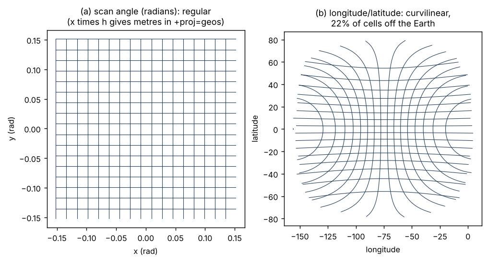

# Worked cases {#sec-cases}

Each case below is a real dataset, chosen because it sits somewhere
specific in @tbl-costumes. Where numbers are quoted they come from the
original analyses cited in `README.md`.

## CryoSat-2 sea ice thickness: cryptic curvilinear {#sec-case-cryosat}

**Stored:** 2D `lon` and `lat`, 316 x 332, no CRS. **Real grid:** regular in
EPSG:3412. **Case:** E.

This is the file from @sec-problem
(`CS2WFA_25km_201007.nc`, Zenodo record 7327711). The detection runs in
three steps. A geometric summary of the coordinates (a centre, an extent and
a principal-axis analysis on the unit sphere) shows circumpolar Antarctic
data with no dominant direction, which points at a polar azimuthal family.
Projected into EPSG:3412, rows are horizontal to within 13 m and steps are
25000 m within about 70 m, a deviation of 0.3%. A genuinely curvilinear grid
would deviate by 10 to 100%. The recovered extent was within 33 m of the
published NSIDC extent, and snapping to multiples of 25 km gives it exactly.

The real file deviates more than the simulation in @tbl-candidates (70 m
rather than 1 m), most likely because its coordinates went through a
different processing chain. Either way the gap to "not regular" is two
orders of magnitude.

## AVISO altimetry: a Mercator grid in longitude and latitude {#sec-case-aviso}

**Stored:** 1D longitude (1080, uniform 1/3 degree) and 1D latitude (915,
varying). **Real grid:** regular in Mercator. **Case:** D.

The file looks rectilinear and most tools treat it so. Converting latitude
to Mercator y makes the steps constant to 1e-12 (@fig-mercator), and the
grid is six numbers in a Mercator CRS with a resolution of about 37 km at
the equator. Treating it as plain longitude and latitude is not wrong for
indexing, but it hides the metric properties the producer actually used.

## MUR GHRSST: degenerate rectilinear with noise {#sec-case-ghrsst}

**Stored:** 1D `lon` (36000) and `lat` (17999) as 32-bit floats. **Real
grid:** regular in longitude and latitude at 0.01 degree. **Case:** C.

A global grid at 0.01 degrees should have 36000 by 18000 cells. This one has
17999 rows: a half row is missing at each pole. The stored longitudes are
offset from cell centres, the 32-bit values are noisy (@fig-float32), and
the global attributes claim ranges of -180 to 180 and -90 to 90 that the
coordinates do not match. GDAL builds a geotransform from the 1D axes, close
to but not exactly the tidy grid. A tidy version can be assigned without
touching the data:

```
vrt://FILE.nc?sd_name=analysed_sst&a_srs=EPSG:4326&a_ullr=-180,89.995,180,-89.995&a_offset=25&a_scale=0.001
```

The `a_scale` and `a_offset` here also convert the packed integers to
degrees Celsius rather than kelvin, replacing the file's own scale and
offset. The choice of extent is a judgement made by a person, which is the
point: the arrays alone do not settle it.

## Three CORDEX Antarctic files: one domain, three frames {#sec-case-cordex}

The CORDEX Antarctic domain (ANT-12) is a good test because three models on
the same domain store their grids in three different ways.

| File | Regular frame | CRS in file | Earth model | Notes |
|---|---|---|---|---|
| HCLIM43-ALADIN | projected metres (stereographic) | yes | sphere, radius 6371229 m | large false easting and northing |
| RACMO24P-NN | rotated longitude and latitude (`rlon`, `rlat`) | yes (rotated pole) | sphere, 6371000 m | the well-made file |
| MAR313 | projected kilometres (stereographic) | broken | WGS84 ellipsoid | needed repair |

: Three files on one domain. {#tbl-cordex}

All three also carry 2D geographic `lon` and `lat`, so all three look
curvilinear to a reader that prefers those arrays. None of them is.

{#fig-rotated}

**RACMO** is regular in rotated longitude and latitude, 0.1 degree steps,
with native `rlon` running from 143.95 to 209.95 across the rotated
antimeridian. There is no projected frame in which it is regular, so no
amount of fitting stereographic projections helps; a blind fit floored at
about 90 km. The regular frame is the rotated angular one, and metres are a
choice imposed later. This is the clearest single example that longitude
and latitude are compatible with a regular grid, and that being in degrees
does not make a grid curvilinear. As @sec-software showed, GDAL's
multidimensional reader gets it right with no options; the classic reader
needs two.

Two lessons came out of RACMO specifically. Do not reproject the 2D arrays
into the rotated frame to "recover" the axes when the axes are on disk:
reprojection wraps longitudes to -180 to 180 and shatters the extent.
And wrap angular differences before testing regularity (@sec-field-guide).

**HCLIM** declares its stereographic CRS. The point of interest is the Earth
model: fitting on an ellipsoid left a residual floor of about 1.1 km that
never reached noise, while a sphere collapsed it to float32 noise (about
0.4 m). The fit can tell a sphere from an ellipsoid. It cannot recover the
latitude of true scale, which only rescales the grid; reading it from the
file gave 11000 m cells, while assuming the domain-typical -71 gave 10700 m,
a 2.8% error that is exactly the scale ratio between the two.

**MAR** is the broken one, and its four defects are a useful checklist:

1. the data variable's `grid_mapping` named "Polar Stereographic", but the
   mapping variable was called `stereographic`, so GDAL dropped the CRS with
   no warning;
2. the mapping had no `grid_mapping_name` and used WKT-style parameter names,
   so a CF reader rejects it even with the reference fixed;
3. `latitude_of_projection_origin` was 90 for an Antarctic grid;
4. an `authority` attribute claimed EPSG:3031 with `lon_0 = 0`, but the
   coordinates fit uniquely with `lon_0 = 20`, the convention in the domain.

Because MAR's `x` and `y` axes are on disk, they pin the scale, so here the
latitude of true scale *is* recoverable: the fit had a sharp minimum. The
repair recipe is in @sec-recipes. One more detail: MAR's axes are in
kilometres, and GDAL rescales them to metres only once a CRS resolves. With
the broken mapping, the same bytes give an extent a thousand times smaller.

## GOES-16 ABI: coordinates without their frame {#sec-case-goes}

**Stored (original NOAA netCDF):** 1D `x` and `y` as packed scan angles, a
`goes_imager_projection` variable with the satellite height and longitude.
**Stored (Earthmover's icechunk copy):** the same `x` and `y` as float64
radians, repeated in four time partitions; the projection is not carried
with them. **Real grid:** regular in scan angle, and so in PROJ's `geos`.
**Case:** B as published; E3 after conversion.

{#fig-goes}

GDAL reads the original file from object storage correctly: it finds the
projection variable, multiplies scan angle by the perspective point height
(35786023 m) and builds a geotransform in
`+proj=geos +h=35786023 +lon_0=-75 +sweep=x`. In the Zarr copy, the
coordinates survive and that step does not. The first three `x` values,
-0.15184399, -0.15178799, -0.15173199 radians, are correct and
meaningless without the frame.

The size arithmetic is the same entropy argument at a larger scale: 5424
float64 values per axis, two axes, four partitions, against six numbers
stored once. And a reader who reaches for the 2D longitude and latitude
instead sees a curvilinear grid with a large region of undefined cells
(@fig-goes b), when the grid is as regular as a GeoTIFF.

## NEMO ORCA: genuinely curvilinear {#sec-case-orca}

**Stored:** 2D `nav_lon` and `nav_lat`. **Real grid:** curvilinear in every
frame. **Case:** H.

The ORCA family of ocean model grids is regular-like in the Southern Ocean
and tropics but deforms in the north so that the grid's singular points sit
on land: a tripolar grid, with two northern poles in North America and Asia
plus the geographic south pole. No projection makes these arrays regular.
They are the grid, and treating them as anything else loses information.
(Note that ORCA is sometimes described as a rotated-pole grid. It is not;
the northern poles are moved by the grid construction, not by rotating the
sphere.)

## VIIRS level 2 swath: curvilinear, but with structure {#sec-case-viirs}

**Stored:** 2D geolocation arrays from the instrument. **Real grid:**
curvilinear; follows the scan geometry. **Case:** H.

A swath is not a reprojected regular grid. Scan lines are not parallel,
cells grow toward the swath edges, and the bow-tie effect duplicates
coverage between scans. Still, the frame matters. A principal-axis analysis
of the swath boundary on the unit sphere found a strongly elongated shape
(85% of variance on the first axis) with a ground track bearing of about 12
degrees. An oblique Mercator aligned to that bearing turns the swath into a
strip about eleven times longer than it is wide. It is still curvilinear,
but it is now easy to subset, tile and plot.

The same analysis exposed a classic trap: the naive mean of the boundary
longitudes, for a swath crossing the antimeridian, put the centre at
(-84.1, -18.3); the spherical centroid was at (-113.6, -20.8).

## OISST: when the frame does the statistics {#sec-case-oisst}

**Stored:** 1D longitude and latitude, quarter degree. **Real grid:**
regular in longitude and latitude. **Case:** C.

This case is about question two doing real work. A daily mean sea surface
temperature over a latitude band needs an area-weighted mean, because
longitude and latitude cells shrink toward the poles. There are three ways
to get it:

1. compute `cos(latitude)` weights and apply them by hand;
2. use xarray's `weighted()` with those weights;
3. warp the data onto a Lambert azimuthal equal-area grid of similar
   resolution and take a plain mean.

In the original experiment all three agreed. The third needs no knowledge of
weights at all: in an equal-area frame every cell has the same area, so an
unweighted mean *is* the area-weighted mean. The frame carries the
correction.

The claim that the warp result matched "exactly" needs care before it is
quoted. A warp resamples, so cells along the band edges and coasts are
partly in and partly out, and the agreement should be stated with the
tolerance actually observed. The code is worth rerunning and publishing
alongside this section.
